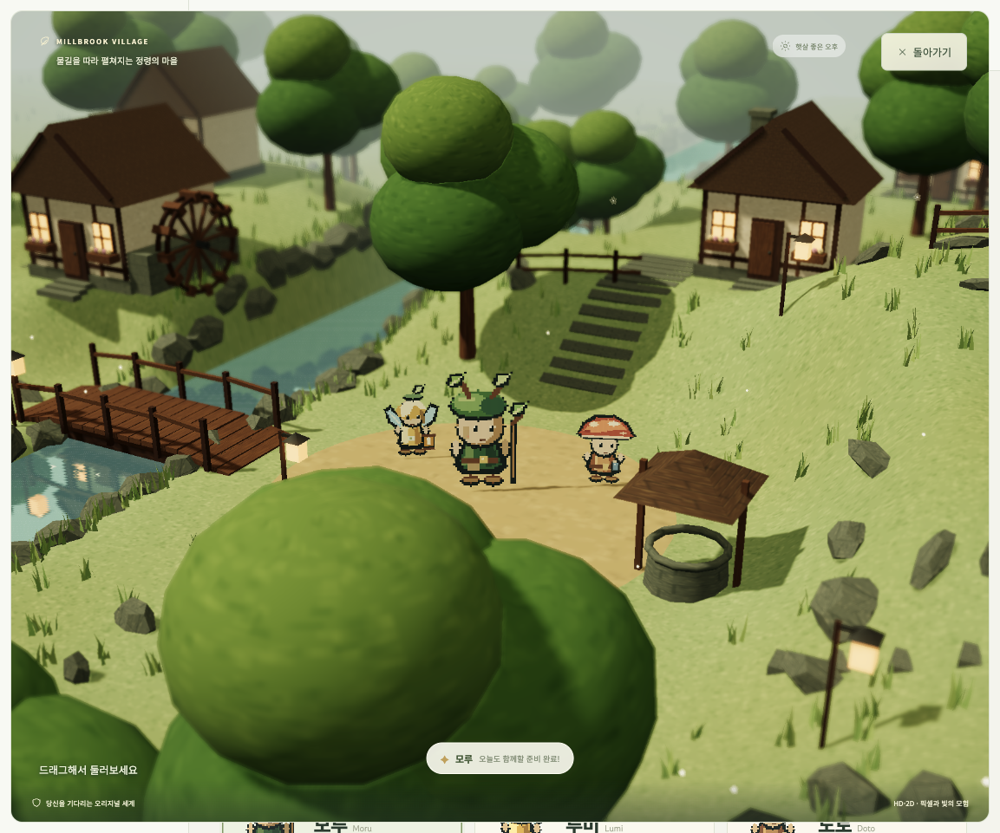
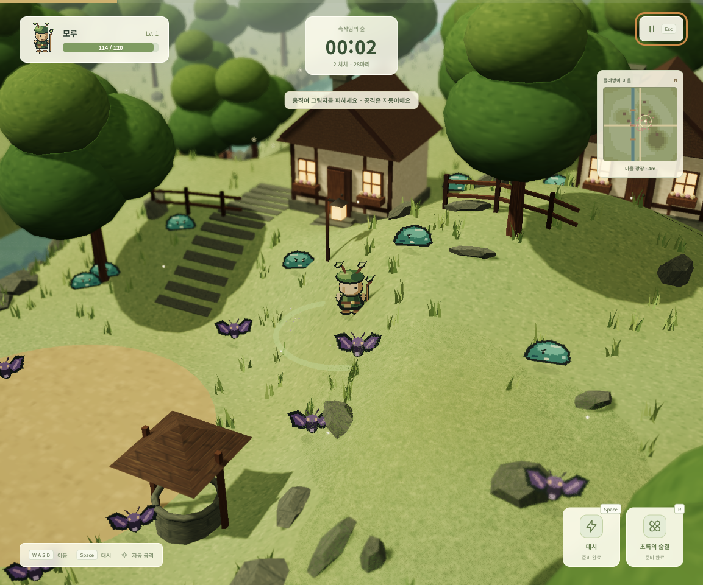
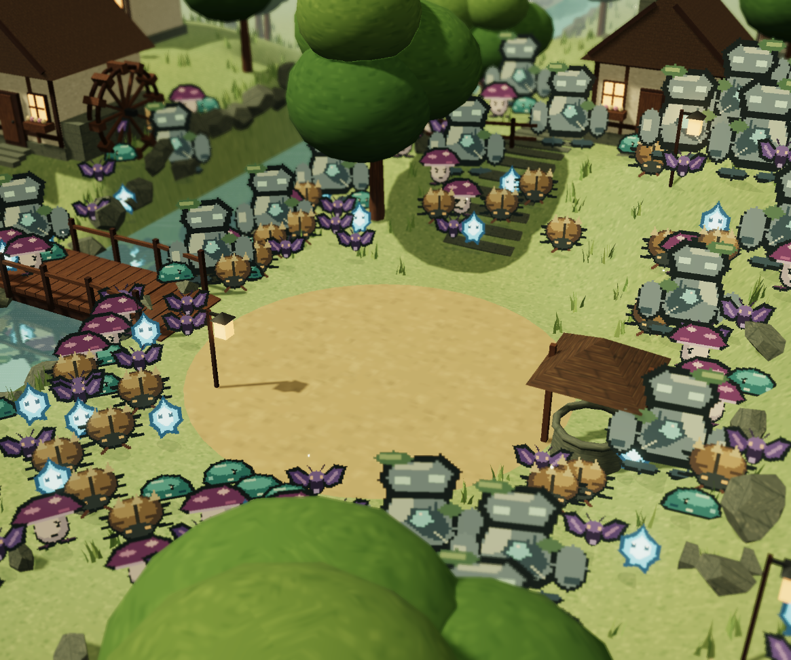

# MOSSBOUND · 숲의 수호자

작은 정령과 함께 숲의 그림자를 물리치는 **싱글 플레이 HD-2D 서바이버**입니다. 직접 그린 2D 픽셀 캐릭터가 입체적인 마을과 언덕을 탐험하며, 자동 공격과 성장·대시·궁극기로 몰려오는 적을 상대합니다.



## 주요 특징

- **픽셀과 3D의 만남** — 48×64 픽셀 정령, 네 방향 걷기 애니메이션, 3D 지형과 건물.
- **빛과 깊이** — 낮과 밤의 조명, 그림자, 실시간 수면 반사, 블룸, 플레이어에 초점을 맞추는 DOF.
- **높낮이 있는 넓은 세계** — 120×120m의 마을과 숲, 물레방아·개울·다리 세 개, 언덕·고원·계단길.
- **몰려오는 그림자** — 시작부터 18마리, 지속적인 증원과 20초마다 추가 무리. 일반 적 스폰 상한은 기본 220마리, 가볍게 모드 140마리입니다.
- **서로 다른 적과 정령** — 플레이 가능한 정령 3종, 일반 적 6종과 보스. 원거리 공격·선회·돌진 등 각자의 행동을 가집니다.
- **쌓이는 모험** — 레벨업 강화, 영구 능력 연구, 도감, 모험 기록과 JSON 내보내기.

## 스크린샷

### 언덕 위의 전투

플레이어와 적은 지형의 높이를 따라 이동합니다. 미니맵은 현재 위치·고도·적의 위치를 표시하고 카메라는 플레이어를 따라갑니다.



### 대규모 그림자 무리

슬라임·나방·독갓 버섯·위습·딱정벌레·돌골렘이 함께 등장합니다. 아래 화면은 **220마리를 배치한 개발용 렌더링 검증 장면**입니다.



## 시작하기

Node.js **20.19 이상인 20.x** 또는 **22.12 이상**과 npm이 필요합니다.

```sh
npm ci
npm run dev
```

터미널에 표시되는 주소를 여세요. 기본 개발 주소는 <http://127.0.0.1:5173>입니다.

프로덕션 빌드를 로컬에서 확인하려면 다음을 실행합니다.

```sh
npm run build
npm run preview
```

배포 파일은 `dist/`에 생성됩니다. 정적 파일 호스팅에 올릴 수 있습니다.

## 조작 방법

공격은 자동입니다. 적과 거리를 유지하며 경험치 씨앗을 모으세요.

| 동작 | 키보드·마우스 | 모바일 |
| --- | --- | --- |
| 이동 | WASD / 방향키 | 왼쪽 아래 조이스틱 |
| 대시 | Space | 대시 버튼 |
| 궁극기 | R | 정령 능력 버튼 |
| 일시 정지 | Esc / 정지 버튼 | 정지 버튼 |
| 레벨업 강화 선택 | 1 / 2 / 3 또는 클릭 | 강화 카드 터치 |
| 로비 카메라 | 드래그로 회전, 휠로 확대 | 드래그·핀치 |
| 풍경 크게 보기 | 미리보기의 확대 버튼 | 미리보기의 확대 버튼 |

확대한 풍경은 돌아가기 버튼 또는 Esc로 닫을 수 있습니다.

## 함께할 정령

| 정령 | 자동 공격 | 궁극기 |
| --- | --- | --- |
| **모루 · 이끼 수호자** | 가까운 적들을 함께 공격하는 새싹 파동 | 주변 공격과 체력 회복 |
| **루미 · 빛의 길잡이** | 여러 표적을 동시에 노리는 반딧불 화살 | 강력한 별빛 범위 공격 |
| **도토 · 버섯 방랑자** | 주변까지 피해를 주는 폭발 도토리 | 주변 공격과 3초 무적 |

레벨 **4·7**에서 정령이 성장하며 공격력·체력이 올라갑니다. 루미는 동시 표적이 늘고, 도토는 폭발 범위가 넓어집니다. 모험에서 얻은 숲의 조각으로 공격력·체력·이동 속도를 영구 강화할 수 있습니다.

## 게임 모드

- **스토리**: 3분 동안 생존하고, 2분 30초에 나타나는 가시왕 그루몽을 물리치면 승리합니다.
- **무한 생존**: 시간 제한 없이 버티며, 90초마다 등장하는 보스에 도전합니다.

그림자 도감에서는 적의 등장 시점과 공격 방식을 확인할 수 있습니다. 포자 탄환을 쏘는 버섯, 주위를 맴도는 불씨, 공격을 예고한 뒤 돌진하는 딱정벌레 등 적에 따라 피하는 방법이 달라집니다.

## 개발 명령

| 명령 | 설명 |
| --- | --- |
| `npm run dev` | 로컬 개발 서버 |
| `npm run build` | 프로덕션 정적 빌드 |
| `npm run preview` | 빌드 결과 미리보기 |
| `npm test` | 전투·지형·증원·스프라이트 테스트 15개 |
| `npm run sprites` | PNG 스프라이트 아틀라스 10개 내보내기 |

### 코드 구성

```text
src/
  main.js              UI, 저장, 도감, 미니맵, 게임 흐름
  world.js             이동, 전투, 성장, 적 행동
  environment.js       고저차 지형, 마을, 다리, 반사와 배경
  encounters.js        초기 무리, 증원 주기와 출현 상한
  pixel-art.js         직접 그린 픽셀 캐릭터와 애니메이션
  hd2d-effects.js       깊이 기반 DOF, 블룸과 톤 매핑
  style.css            반응형 화면과 HUD
public/sprites/        내보낸 PNG 아틀라스와 배치 설명
scripts/               스프라이트 내보내기 도구
tests/                 시뮬레이션 테스트와 시각 검증 장면
docs/                  분석·구현 기록과 스크린샷
```

스프라이트의 원본은 `src/pixel-art.js`입니다. 원본을 수정한 뒤 `npm run sprites`를 실행하면 192×256 PNG 아틀라스와 `atlas.json`을 다시 만듭니다. 게임도 같은 원본에서 픽셀 텍스처를 생성합니다.

개발 서버에서는 아래 경로로 시각 검증 장면을 확인할 수 있습니다. 이 HTML은 프로덕션 엔트리에 포함되지 않습니다.

- `/tests/visual.html`: 일반 적 6종을 함께 배치한 장면
- `/tests/visual.html?horde=1`: 220마리 규모의 장면

## 실행 환경과 저장

WebGL 2를 지원하는 브라우저에서 플레이합니다. 설정의 **가볍게** 모드는 DOF·블룸·실시간 반사·그림자를 끄고 렌더 해상도를 낮춥니다.

진행 상황은 현재 브라우저의 `localStorage`에 저장됩니다. 최근 30회 모험을 보관하며 설정에서 기록을 JSON으로 내보낼 수 있습니다. 계정·서버 동기화·온라인 협동·클랜·전 세계 랭킹·결제 기능은 제공하지 않습니다. Google Fonts를 불러올 수 없으면 시스템 글꼴로 표시합니다.

## 제작 배경과 문서

PokéBonk의 공개 화면과 배포 부트 번들을 REA로 분석해 게임 구조를 참고했습니다. 캐릭터·픽셀 스프라이트·3D 배경·효과음은 MOSSBOUND를 위해 새로 제작했으며, 포켓몬 이름·캐릭터 에셋·원본 게임 코드를 포함하지 않습니다.

- [REA 분석 기록과 근거](docs/REA-ANALYSIS.md)
- [HD-2D 구현과 검증](docs/HD2D.md)
- [디자인 방향](DESIGN.md)
